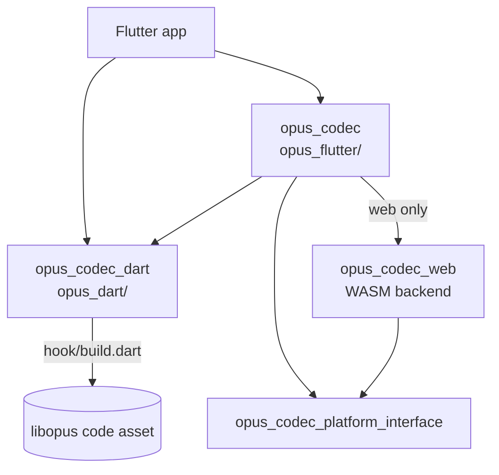
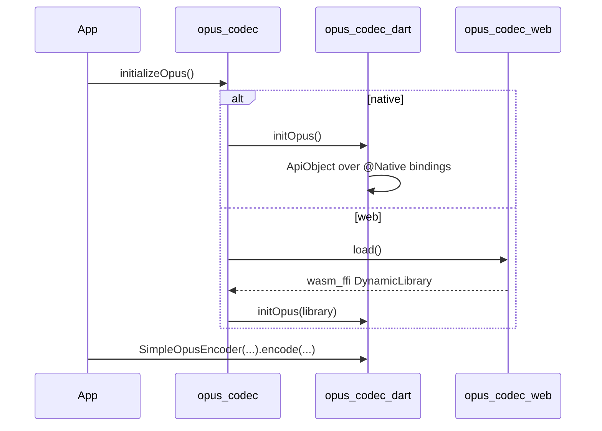

# Architecture

This describes the 4.x design. Releases up to 3.x shipped a federated plugin
with one prebuilt libopus per platform; that design is retired.
[macos-xcframework-distribution.md](./macos-xcframework-distribution.md)
records why and how the migration was planned.

## Overview

`opus_codec_dart` owns libopus: the vendored sources, the build hook, the
bindings and the Dart API. Native platforms compile libopus during the app
build as a [code asset](https://dart.dev/tools/hooks), so no platform plugin
or prebuilt binary is involved. The web uses a WASM build of the same
sources.

`opus_codec` is a thin Flutter facade with one entry point,
`initializeOpus()`, which works on every platform.

## Package dependency graph



Publish order follows the graph: `opus_codec_dart` and the platform
interface, then `opus_codec_web`, then `opus_codec` (`scripts/publish.sh`).

## Native build

```text
opus_dart/
├── hook/build.dart            # the only native build entry point
├── native/
│   ├── libopus.json           # version, archive URL, SHA-256, feature policy
│   ├── sources.json           # compile groups and include dirs (generated)
│   ├── checksums.sha256       # digest of every vendored file (generated)
│   ├── config/config.h        # PACKAGE_VERSION (generated)
│   ├── shim/                  # fixed-signature CTL bridge
│   └── vendor/opus/           # byte-identical upstream files + COPYING
├── lib/src/native/
│   ├── opus_bindings.dart     # ffigen output, @Native bound to the asset
│   └── api_adapter.dart       # bindings → existing wrapper interfaces
└── tool/ffigen.dart           # regenerates opus_bindings.dart
```

The hook runs for every build that depends on `opus_codec_dart`:

1. It returns immediately unless the build requests code assets (web does
   not).
2. It rejects targets outside the support matrix in the package README.
3. It reads `sources.json` and `libopus.json` and compiles one dynamic library
   named `opus_codec` with `native_toolchain_c`, for the target OS and
   architecture the SDK requests.
4. It publishes the library as the code asset
   `package:opus_codec_dart/src/native/opus_bindings.dart`, bundled into the
   app.

Build settings mirror upstream's CMake shared build: `OPUS_BUILD`,
`HAVE_CONFIG_H`, `ENABLE_HARDENING`, `VAR_ARRAYS` (`USE_ALLOCA` on MSVC),
`DLL_EXPORT` on Windows, hidden symbol visibility, and `-Bsymbolic` on ELF so
calls inside the library cannot be interposed by another libopus in the
process. The baseline is float, generic C, without DNN features or custom
modes.

## Bindings and initialization

`opus_bindings.dart` is generated by ffigen from the vendored headers and the
shim header. It covers exactly the functions the codec uses; the list in
`tool/ffigen.dart` is the ABI contract. A library-level `@DefaultAsset`
binds every declaration to the code asset, so lookups never fall back to a
libopus already loaded in the process. CI regenerates the file and fails on
any difference.

`api_adapter.dart` implements the wrapper interfaces
(`OpusEncoderFunctions` and friends) on top of the bindings, so the
high-level encoder, decoder and stream classes, and their mock tests, are
unchanged.



`initOpus()` is idempotent and per isolate. On native it rejects a library
argument; on web it requires one. `proxy_ffi.dart` keeps `dart:ffi` and the
`@Native` declarations out of web compilation through conditional exports.

### CTL bridge

`opus_encoder_ctl` is variadic, which Dart FFI cannot call portably.
`native/shim/opus_codec_shim.c` exports `opus_codec_encoder_ctl_int`, which
accepts only integer-valued setter requests and returns `OPUS_BAD_ARG` for
anything else, so a getter can never write through an integer. Native and web
compile the same shim.

## Web backend

`opus_codec_web` ships `libopus.js` and `libopus.wasm`. `./build_wasm.sh`
builds them in Docker from `opus_dart/native`, using the same `sources.json`
and defines as the hook, so the web binding uses the same
`opus_codec_encoder_ctl_int` shim as native.

## Updating libopus

`scripts/vendor_libopus.py` is the only way the vendored tree changes:

- `--update VERSION` pins a release from Xiph's `SHA256SUMS.txt`, downloads
  it, verifies the digest, takes the compile groups from upstream's own `.mk`
  lists, copies those sources and their transitive includes, and regenerates
  `sources.json`, `config.h` and `checksums.sha256`. An include it cannot
  resolve fails the run unless it is listed, with a reason, in
  `OPTIONAL_INCLUDES`.
- `--check` re-verifies every digest offline; CI and the publish workflow run
  it.

`.github/workflows/update-libopus.yml` runs this weekly. It vendors and
tests on macOS without write credentials, rebuilds the WASM, and only then
opens one PR with everything a reviewer needs. Merging and releasing stay
manual.

## Opus version

libopus **1.6.1**, pinned in `opus_dart/native/libopus.json`.
`getOpusVersion()` returns the linked library's own string, for example
`libopus 1.6.1`.

## Example app

`opus_flutter/example` records audio, encodes it to Opus and plays it back.
It calls `opus_codec.initializeOpus()` once in `main()`.
